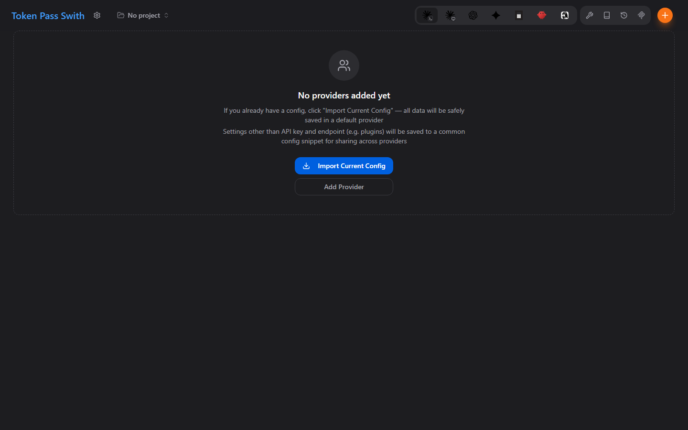

# Token Pass Swith



Token Pass Swith is a desktop workstation for Token Pass relay endpoints and
AI assistant clients. It manages local profiles for Claude Code, Claude
Desktop, Codex, Gemini CLI, OpenCode, OpenClaw, and Hermes, then projects the
selected profile into each client's live configuration.

Token Pass Swith is an independent derivative of the open-source
[CC Switch](https://github.com/farion1231/cc-switch) project, distributed under
the MIT License. It is not an official CC Switch release, is not affiliated
with or endorsed by the CC Switch authors, and does not represent their views.

Read this document in [Chinese](README_ZH.md) or [Russian](README_RU.md).

## Downloads and Updates

- Public source: `https://github.com/xpxueA/token-pass-swith`
- Downloads: `https://tokenpass.cloud/downloads/token-pass-swith/`
- Updater manifest: `https://tokenpass.cloud/downloads/token-pass-swith/latest.json`

Only signed releases published through the project release workflow are
official Token Pass Swith builds.

## Local Development

```bash
pnpm install --frozen-lockfile
pnpm typecheck
pnpm test:unit
pnpm tauri dev
```

Build the desktop application with `pnpm tauri build`.

## Security

Do not commit API keys, relay credentials, signing keys, customer data, or
internal endpoint secrets. Report vulnerabilities through
[GitHub Security Advisories](https://github.com/xpxueA/token-pass-swith/security/advisories/new).

## License and Attribution

Token Pass Swith is released under the [MIT License](LICENSE). Upstream and
derivative-work attribution is recorded in [NOTICE.md](NOTICE.md), and bundled
software and artwork notices are recorded in
[THIRD_PARTY_NOTICES.md](THIRD_PARTY_NOTICES.md).

Service names and logos identify compatible services only. They remain the
property of their respective owners and do not imply affiliation or endorsement.
