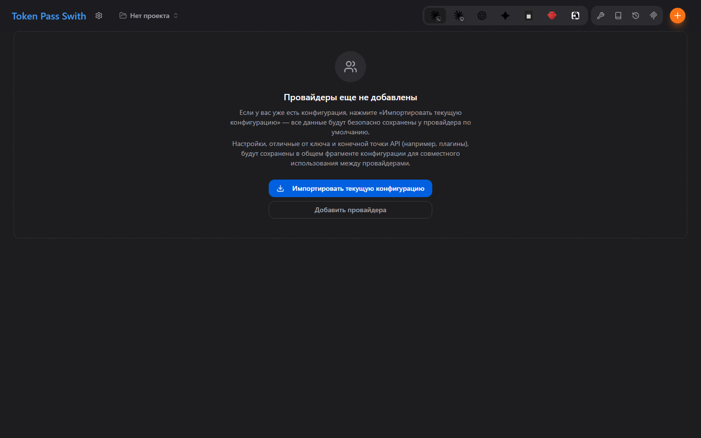

# Token Pass Swith



Token Pass Swith — настольное приложение для конечных точек Token Pass и
клиентов ИИ. Оно управляет локальными профилями Claude Code, Claude Desktop,
Codex, Gemini CLI, OpenCode, OpenClaw и Hermes и применяет выбранный профиль к
активной конфигурации клиента.

Token Pass Swith — независимый проект, созданный на основе открытого проекта
[CC Switch](https://github.com/farion1231/cc-switch) и распространяемый по
лицензии MIT. Он не является официальной версией CC Switch, не связан с
авторами CC Switch, не одобрен ими и не представляет их позицию.

Другие языки: [English](README.md) · [中文](README_ZH.md)

## Загрузки и обновления

- Открытый исходный код: `https://github.com/xpxueA/token-pass-swith`
- Загрузки: `https://tokenpass.cloud/downloads/token-pass-swith/`
- Манифест обновлений: `https://tokenpass.cloud/downloads/token-pass-swith/latest.json`

Официальными сборками Token Pass Swith являются только подписанные выпуски,
созданные проектным процессом публикации.

## Локальная разработка

```bash
pnpm install --frozen-lockfile
pnpm typecheck
pnpm test:unit
pnpm tauri dev
```

Для сборки настольного приложения используйте `pnpm tauri build`.

## Безопасность

Не добавляйте в репозиторий API-ключи, учетные данные ретранслятора, ключи
подписи, данные клиентов и внутренние секреты. Сообщайте об уязвимостях через
[GitHub Security Advisories](https://github.com/xpxueA/token-pass-swith/security/advisories/new).

## Лицензия и указание авторства

Проект распространяется по [лицензии MIT](LICENSE). Сведения об исходном и
производном проекте находятся в [NOTICE.md](NOTICE.md), а сведения о зависимостях
и графических материалах — в [THIRD_PARTY_NOTICES.md](THIRD_PARTY_NOTICES.md).
Названия и логотипы сервисов используются только для обозначения совместимости,
принадлежат их владельцам и не означают партнерства или одобрения.
