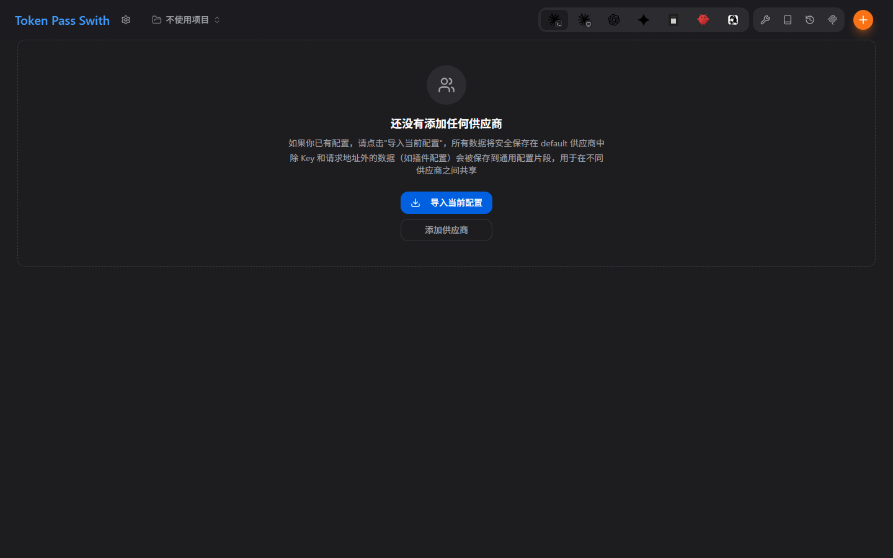

# Token Pass Swith



Token Pass Swith 是面向 Token Pass 中转端点和 AI 助手客户端的桌面工作台。它管理
Claude Code、Claude Desktop、Codex、Gemini CLI、OpenCode、OpenClaw 和 Hermes
的本地供应商配置，并把当前选中的配置写入对应客户端的 live 配置。

Token Pass Swith 基于开源项目
[CC Switch](https://github.com/farion1231/cc-switch) 二次开发，遵循 MIT License，
由 Token Pass Swith 社区独立维护。本项目不是 CC Switch 原作者的官方版本，与原作者
不存在隶属或认可关系，也不代表原作者立场。

## 开放使用

无需 Token Pass 账号、激活码或订阅，安装后即可使用。设置中的第三方连接只用于用户
主动连接 GitHub Copilot、ChatGPT/Codex 和 Gemini，不是 Token Pass Swith 的登录门槛。

其他语言：[English](README.md) · [Русский](README_RU.md)

## 下载与更新

- 公开源码：`https://github.com/xpxueA/token-pass-swith`
- 下载地址：`https://tokenpass.cloud/downloads/token-pass-swith/`
- 更新清单：`https://tokenpass.cloud/downloads/token-pass-swith/latest.json`

只有通过项目发布流程产生并完成签名的安装包才是官方 Token Pass Swith 构建。

## 本地开发

```bash
pnpm install --frozen-lockfile
pnpm typecheck
pnpm test:unit
pnpm tauri dev
```

使用 `pnpm tauri build` 构建桌面应用。

## 安全

不要提交 API Key、中转站凭据、签名密钥、客户数据或内部端点 secret。安全漏洞请通过
[GitHub Security Advisories](https://github.com/xpxueA/token-pass-swith/security/advisories/new)
私下报告。

## 许可与归属

本项目使用 [MIT License](LICENSE)。上游和二次开发归属记录在 [NOTICE.md](NOTICE.md)，
依赖及图标来源记录在 [THIRD_PARTY_NOTICES.md](THIRD_PARTY_NOTICES.md)。厂商名称和标志
仅用于标识兼容服务，权利归各自所有者，不代表合作、赞助或认可。
